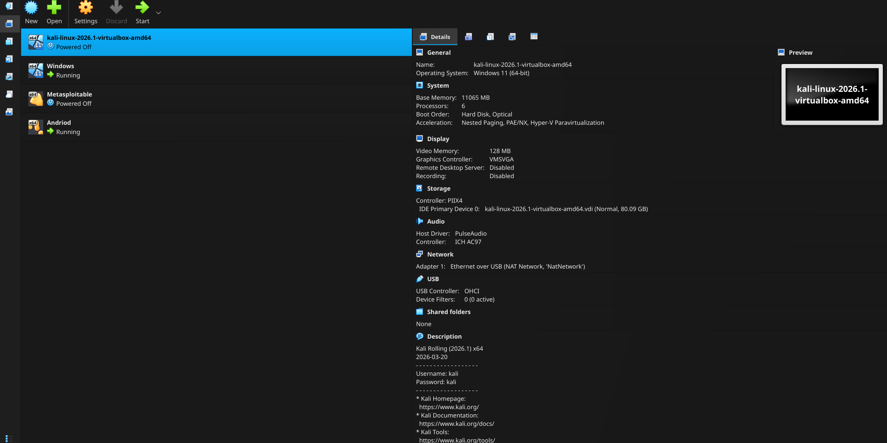
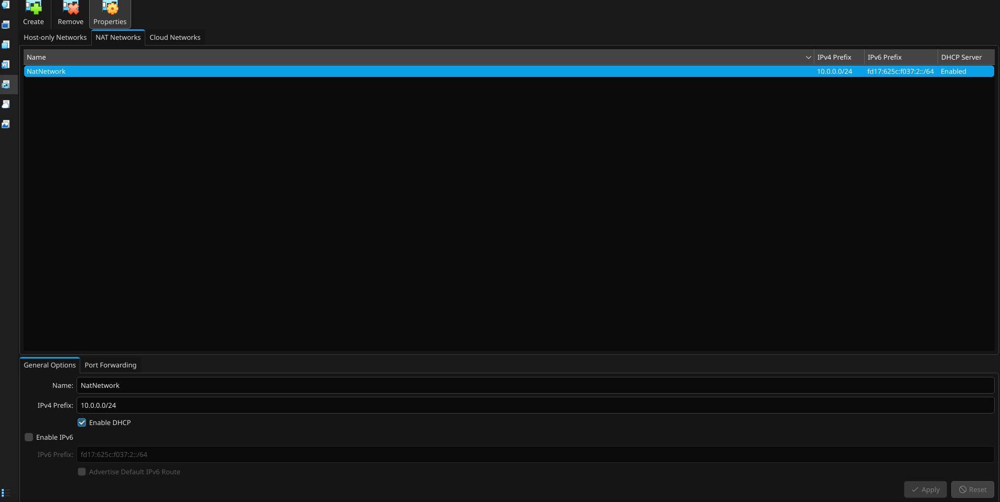
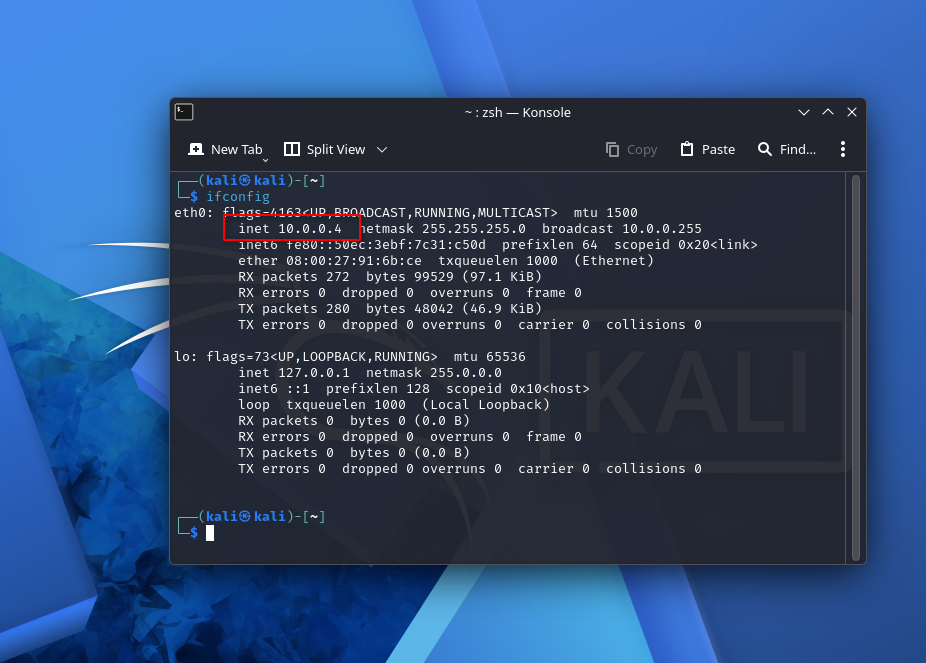
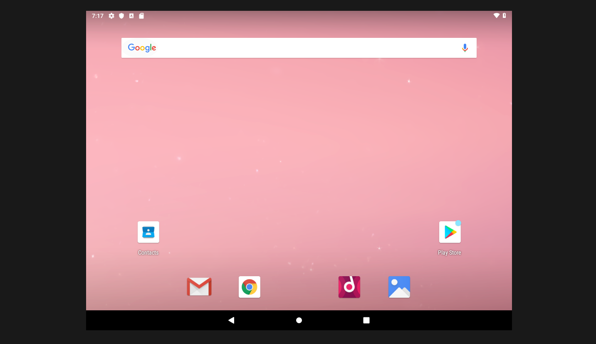
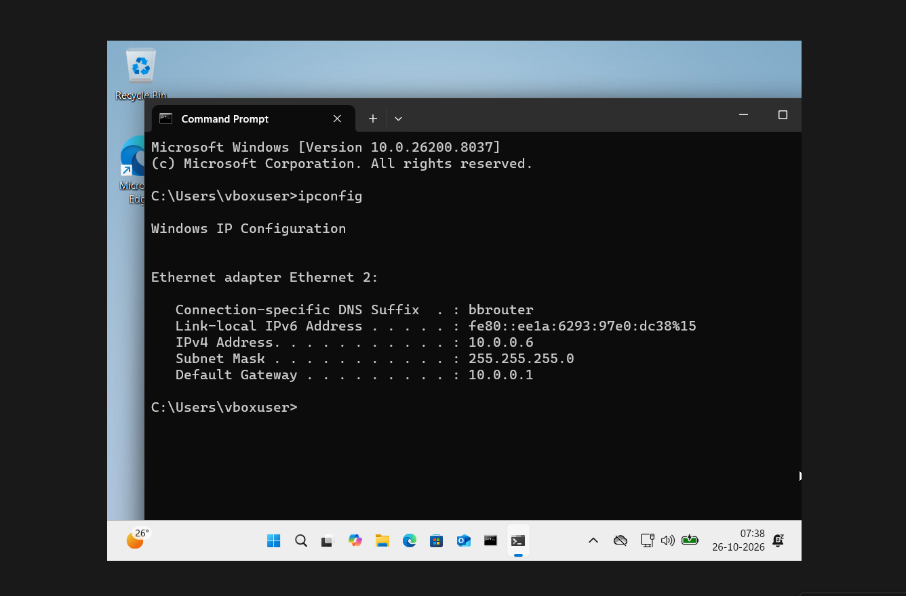

# VirtualBox Multi-VM Networking Lab

**Author:** Sudip Patra

## 1. Project Overview

This project documents my completed setup of a multi-virtual-machine lab using Oracle VirtualBox. The environment was prepared for learning virtual networking and carrying out cybersecurity exercises in a controlled lab.

The lab includes Kali Linux, Windows, and Android virtual machines. A Metasploitable virtual machine is also present for future practice with intentionally vulnerable systems. I configured a shared VirtualBox NAT Network and checked the network configuration shown inside Kali Linux and Windows.

## 2. Project Objectives

- Set up and manage multiple virtual machines in Oracle VirtualBox.
- Import and run the Kali Linux virtual machine.
- Create a shared NAT Network for communication between lab VMs.
- Configure the network using the IPv4 subnet `10.0.0.0/24`.
- Enable DHCP for automatic IP address assignment.
- Check the network settings in Kali Linux and Windows.
- Set up an Android virtual machine.
- Keep a reusable virtual lab environment for future networking and cybersecurity practice.
- Capture screenshots as evidence of the completed configuration.

## 3. Tools and Technologies Used

- **Oracle VirtualBox** — virtualization platform used to create and manage the virtual machines.
- **Kali Linux** — Linux environment for networking and authorized cybersecurity exercises.
- **Windows** — guest operating system used to verify its assigned IP configuration.
- **Android virtual machine** — additional guest system included in the lab.
- **Metasploitable** — intentionally vulnerable VM available for future controlled security testing.(Extra)
- **VirtualBox NAT Network** — shared virtual network connecting compatible guest VMs.
- **Command Prompt (`ipconfig`)** — used to inspect Windows network configuration.
- **Kali terminal (`ifconfig`)** — used to inspect the Kali network interface.

## 4. Virtual Lab Environment

The VirtualBox manager contains the Kali Linux, Windows, Metasploitable, and Android virtual machines. The screenshot below records the overall VM setup.



*Figure 1: VirtualBox manager showing the configured virtual machines.*

## 5. NAT Network Configuration

I created a VirtualBox NAT Network with the following configuration:

| Setting | Value shown in the screenshots |
|---|---|
| Network name | `NatNetwork` |
| IPv4 prefix | `10.0.0.0/24` |
| DHCP | Enabled |
| Windows IPv4 address | `10.0.0.6` |
| Windows subnet mask | `255.255.255.0` |
| Windows default gateway | `10.0.0.1` |
| Kali Linux IPv4 address | `10.0.0.4` |

The subnet `10.0.0.0/24` provides addresses in the `10.0.0.x` range. DHCP is enabled to assign addresses automatically. The screenshot below shows the NAT Network settings.



*Figure 2: NAT Network configured with the `10.0.0.0/24` prefix and DHCP enabled.*

These addresses represent the captured setup. Since DHCP is enabled, assigned addresses may change after a lease renewal or a network reconfiguration.

## 6. Kali Linux Network Configuration

I checked the Kali Linux network interface using `ifconfig`. The captured configuration shows the `eth0` interface with IPv4 address `10.0.0.4` and subnet mask `255.255.255.0`.



*Figure 3: Kali Linux network interface configuration.*

## 7. Android Virtual Machine Setup (Extra Work)

The Android virtual machine was set up and launched in VirtualBox, as shown below.



*Figure 4: Android VM running in the virtualized lab environment.*

## 8. Windows Network Configuration (Extra Work)

I checked the Windows network settings using the `ipconfig` command in Command Prompt. The screenshot shows the following values:

- **IPv4 address:** `10.0.0.6`
- **Subnet mask:** `255.255.255.0`
- **Default gateway:** `10.0.0.1`



*Figure 5: Windows Command Prompt displaying the IP configuration.*

The Kali Linux and Windows addresses shown above belong to the same `10.0.0.0/24` subnet. These are the values visible in the captured screenshots; DHCP assignments may change in future sessions.

## 9. Completed Tasks

### 9.1 Virtual machine setup

- Set up the virtual machines in Oracle VirtualBox.
- Imported the Kali Linux virtual machine.
- Started the Windows and Android virtual machines.
- Kept the Metasploitable virtual machine available for later lab exercises.

### 9.2 Virtual network setup

- Created the NAT Network named `NatNetwork`.
- Configured its IPv4 prefix as `10.0.0.0/24`.
- Enabled DHCP.
- Connected the relevant VMs to the lab network.

### 9.3 Network configuration checks

- Ran `ipconfig` in Windows Command Prompt.
- Checked the Kali Linux network interface using `ifconfig`.
- Observed Windows at `10.0.0.6/24` with gateway `10.0.0.1`.
- Observed Kali Linux at `10.0.0.4/24`.

## 10. Problem Faced during the set up

During setup, I faced an issue while configuring the VirtualBox NAT Network. The network setup was not working as expected, which interrupted the planned network configuration of the virtual machines.

I resolved the issue by selecting the **`usbnet` option** in the relevant network configuration. After choosing this option, I was able to continue with the lab setup and configure the virtual network.

This troubleshooting step was important because the lab depends on correct network adapter settings for the virtual machines to use the intended network. The exact adapter option available can depend on the VirtualBox version and the VM configuration.

## 11. Project Outcome

The virtual lab environment was set up in VirtualBox, a shared NAT Network was configured, and network settings were checked in both Kali Linux and Windows. The Android VM was also set up, and Metasploitable is available for future controlled practice.

The project provided practical experience with virtual machine management, NAT Network configuration, DHCP, IPv4 addressing, and basic network troubleshooting.

## 12. Future Scope

Possible next steps for this lab include:

- Testing and recording connectivity between the virtual machines.
- Verifying routing and DNS behavior from each guest OS.
- Taking snapshots after reaching a stable configuration.
- Performing authorized network discovery and vulnerability assessment in the isolated lab.
- Recording commands used and adding screenshots of future test results.
- Updating the network table if DHCP assigns different addresses.

## 13. Safety and Responsible Use

This lab is intended for educational purposes. I will limit security testing to virtual machines and systems I own or have explicit permission to assess. Intentionally vulnerable systems such as Metasploitable should remain confined to the lab and should not be exposed to public or production networks.

## 14. Repository Structure

Keep the README and image files together in the root of the repository so GitHub can display the embedded screenshots correctly.

```text
.
├── README.md
├── 1.Full_Setup.png
├── 2.NAT_Setup.png
├── 3.Kali_Network_config.png
├── 4.Android_setup.png
└── 5.Windows_Setup.png
```

---
**Project:** VirtualBox Multi-VM Networking Lab  
**Author:** Sudip Patra  
**Status:** Initial virtual machine and network setup completed
# NW-WK1-Project
